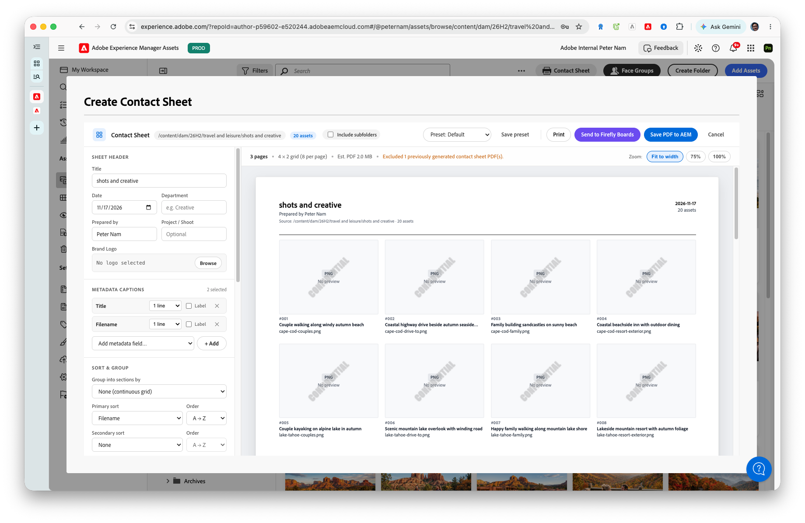

# AEM Assets Contact Sheets & Firefly Boards Exporter

An Adobe App Builder application for **AEM Assets View (`aem/assets/assetsview/1`)** and **AEM Content Hub (`aem/assets/contenthub/1`)** that generates customizable, print-ready **PDF Contact Sheets** (saved back to AEM Assets and immediately downloadable) and exports high-resolution contact-sheet grids directly to **Adobe Firefly Boards** (infinite canvas).

## Demo Video & Overview

- **Watch the Demo on YouTube:** [https://youtu.be/wgfEXvkFBYM](https://youtu.be/wgfEXvkFBYM)

[](https://youtu.be/wgfEXvkFBYM)

---

## Features & Capabilities

### 1. Dual Entry Points: AEM Assets View & Content Hub
- **Unified Extension Bundle (`src/shared-ui/unified-entry.js`):** Single `register()` entry point supporting both **AEM Assets View** (`aem/assets/assetsview/1`: `headerMenu`, `actionBar`, `quickActions`) and **AEM Content Hub** (`aem/assets/contenthub/1`: `card` collection tiles, `selectionBar` multi-selection).
- **Content Hub Fast Initialization:** Automatically detects `tier = delivery`, skips Assets View–only host RPC calls (`getCurrentUserProfile`, `getAemHost`) that would time out in Content Hub, decodes user claims from the IMS JWT, and normalizes `x-api-key` to `aem-assets-frontend-1` for Author archival uploads.
- **Recursive Subfolder Toggle (`Include subfolders`):** When launched on any folder in Assets View, a top-bar **Include subfolders** checkbox pill dynamically re-resolves all descendant assets across nested subfolders (`repo:ancestors`) in place without losing your current configuration.

---

### 2. Adobe Spectrum 2 Native UI & Responsive Live Preview
- **Spectrum 2 Inspector & Stage (`src/shared-ui/components/ContactSheetDialog.js`):**
  - Clean `56px` Spectrum 2 top bar with AEM grid badge, source breadcrumb pill, asset count badge, preset selector, and action pills (**Print**, **Send to Firefly Boards**, **Save PDF to AEM**, **Cancel**).
  - `360px` Left Inspector Rail paired with a responsive right-hand preview stage.
- **Responsive Viewport Page Scaling (`packages/core/render.js`):**
  - Uses a `ResizeObserver` inside the preview iframe to compute `--cs-scale = (availableWidth - 64) / (pageWidthIn * 96)`, scaling any paper size (`Letter`, `A4`, `Legal`, `Tabloid`, `A3`, portrait or landscape) smoothly to the available canvas width after accounting for the left sidebar, with **Fit to width**, **75%**, and **100%** zoom controls.
  - Includes `@media print { transform: none !important }` so browser printing outputs exact 1:1 physical inches.
- **Universal Preview Thumbnails (Approved, Rejected, Draft & Unpublished Assets):**
  - Loads authenticated Dynamic Media JPEGs (`?width=350&quality=75`) for approved/published assets and falls back to `GET /browse?mode=thumbnails` (fetching AEM's compact `cq5dam.thumbnail.140.100.png` rendition in 5-asset batches well under OpenWhisk's 1 MB limit) so unapproved, rejected, and unpublished Author assets all display thumbnails in the Live Preview.

---

### 3. Sheet Header & Centered, Top-Aligned Brand Logo
- **Header Fields:** Custom **Title**, **Date**, **Department**, **Prepared by**, **Project / Shoot**, plus automatic **Source** path and **Asset Count**.
- **Inline Brand Logo Picker with DAM Search & Small Thumbnails (`actions/browse/index.js`):**
  - Opens inline directly underneath the **Brand Logo** field, starting in the current shoot's parent folder (e.g., `/content/dam/26H2/hertz` where `brand/hertz-logo-black.png` lives).
  - Includes a DAM-wide search input (`Search logo across DAM (e.g. hertz, logo)…`) and embeds AEM's pre-generated small thumbnails (`cq5dam.thumbnail.140.100.png` / `48.48.png`) as `data:` URLs next to each image filename.
- **Centered & Top-Aligned Placement:**
  - The selected Brand Logo is **horizontally centered and top-aligned** across the Live Preview (3-column CSS Grid `.header-center`), HTML-to-PDF (`packages/core/render.js`), native vector PDF (`actions/lib/pdf-native.js`), and Firefly Boards (`actions/lib/firefly-boards.js`), and is remembered per user (`prefs`).

---

### 4. Metadata Captions, Multi-Level Sorting & Section Grouping
- **Friendly Metadata Discovery & Coverage Ranking (`packages/core/fields.js`):**
  - Discovers all `assetMetadata` and `repositoryMetadata` fields across resolved assets, ranks them by population coverage, and maps raw property names to human-readable labels (`Vehicle Class`, `Campaign Name`, `Dimensions`, `File Size`, `Orientation`, `Folder`—never raw `xdm:*` or `repo:*` IDs).
- **Per-Thumbnail Captions:**
  - Configure which fields print beneath each thumbnail, with **1–3 line clamping** and an optional **Label** prefix toggle per field.
- **Multi-Level Natural Sort & Widow-Safe Grouping (`packages/core/sort.js`, `packages/core/layout.js`):**
  - Natural alphanumeric sorting (`img_2.jpg` before `img_10.jpg`) with empty values always sorted last in both ascending (`A → Z`) and descending (`Z → A`) order.
  - Primary and Secondary sort keys across all common fields and user-selected printed metadata fields.
  - Optional **Group into sections by** any groupable field (`Folder`, `Orientation`, `Vehicle Class`, `Team`, `Apparel Type`, etc.) with styled section header banners that are never left widowed at the bottom of a page.

---

### 5. Watermarks & Standalone Watermark Presets
- **Configurable Watermark Overlay (`packages/core/layout.js`, `packages/core/render.js`, `actions/lib/pdf-native.js`):**
  - **Watermark Text:** Custom text input (defaults to `CONFIDENTIAL`).
  - **Font Family (System Fonts + Automatic AEM DAM Font Discovery):**
    - Defaults to a **Blocky Impact** font (`Impact, "Arial Black", "Helvetica Neue Condensed Black"`), plus *Bold Sans*, *Condensed Display*, *Classic Serif Bold*, and *Monospace Stamp*.
    - Automatically discovers custom `.ttf`, `.otf`, `.woff`, and `.woff2` fonts from **`/content/dam/fonts`** AND searches across the entire DAM by `dc:format` (`font/ttf`, `font/otf`, `font/woff`, `font/woff2`) so fonts stored under any folder convention (e.g., `/content/dam/.../Document fonts/Gotham-Black.otf`) appear automatically in the dropdown.
    - Renders custom DAM fonts via `@font-face` in the Live Preview and embeds `.ttf`/`.otf` binaries directly into the vector PDF via `@pdf-lib/fontkit`.
  - **Position:** `Center` (default), `Top Left`, `Top Right`, `Bottom Left`, or `Bottom Right`.
  - **Angle:** Preset angles (`45° Diagonal ↗` default, `-45° Diagonal ↘`, `0° Horizontal`, `30°`, `-30°`, `60°`, `-60°`, `90° Vertical`) plus a numeric degree input (`-90°` to `90°`).
  - **Opacity & Surface Coverage:** Sliders for **Opacity** (`10%–90%`, default `35%`) and **Asset Coverage** (`20%–90%` of thumbnail span, default `60%`).
  - **Dual-Contrast Grey:** Rendered in neutral mid-grey (`#888888` / `rgb(0.56, 0.56, 0.56)`) with a subtle dark/light halo so watermarks are legible on **both pure white and pure black assets**.
- **Standalone Watermark Presets (`actions/presets/index.js`):**
  - Includes starter watermark presets (`CONFIDENTIAL (45° Center)`, `FPO — DO NOT DISTRIBUTE`, `DRAFT (Bottom Right)`) and a dedicated **Save preset** button in the Watermark section so watermark presets can be saved and applied independently of layout presets.

---

### 6. Page Layout, Themes, Status Badges & Clickable Deep Links
- **Layout Controls:** Paper size (`Letter`, `A4`, `Legal`, `Tabloid`, `A3`), Orientation (`Landscape`, `Portrait`), Grid columns (`2–6`), Thumbnail aspect ratio (`4:3`, `1:1`, `3:2`, `16:9`, `3:4`), Thumbnail fit (`Contain`, `Cover`), Resolution (`Screen 150 ppi`, `Print 300 ppi`), Page numbers, and Asset sequence `#`.
- **Page Themes (`THEME_PALETTES`):**
  - **Clean White (`#ffffff`)** — Default
  - **Photographer Dark (`#18181b`)** — Charcoal canvas with `#27272a` frames and light text for color-accurate photo/video review
  - **Neutral Proofing Grey (`#52525b`)** — 50% neutral proofing surround with `#3f3f46` frames
- **Approval Status Badges (`Status badges`):**
  - Overlays a Spectrum 2 status pill in the top-right corner of each thumbnail in both the Live Preview and PDF (`APPROVED` green `#05834e`, `REJECTED` red `#d73220`, `PENDING` / `DRAFT` amber `#cb6f10`).
- **Clickable Deep Links in PDF & Preview (`Clickable AEM links`):**
  - Attaches a native PDF `URI` link annotation (`Subtype: 'Link'`) over every thumbnail cell in `pdf-lib` (and `<a>` links in preview):
    - **From AEM Assets View (`tier = author`):** Opens `https://experience.adobe.com/?repoId=author-p59602-e520244.adobeaemcloud.com#/assets/detail/content/dam/...`
    - **From AEM Content Hub (`tier = delivery`):** Opens `https://experience.adobe.com/?repoId=delivery-p59602-e520244.adobeaemcloud.com#/assets/contenthub/assets/urn:aaid:aem:...`

---

### 7. Save PDF to AEM, Sequence Deduplication, Read-Only Fallback & Instant (`< 1s`) Download
- **Save to AEM Assets (`actions/lib/aem.js`, `actions/generate-worker/index.js`):**
  - In **Assets View**, saves to the user's selected AEM folder (remembered in `prefs`, defaulting to the current folder or `/content/dam/contact-sheets/{yyyy}/{mm}/`).
  - In **Content Hub**, saves an archival copy to `/content/dam/contact-sheets/content-hub/{yyyy}/{mm}/` on AEM Author.
  - Patches `xmp:CreatorTool = "AEM Contact Sheet"` onto every generated PDF so future contact sheets automatically exclude previously generated contact sheet PDFs.
- **Duplicate Filename Sequence Suffixing (`resolveUniqueFileName`):**
  - Uses `{title-slug}_{yyyy-mm-dd}.pdf` and automatically appends incrementing sequence numbers (`-1.pdf`, `-2.pdf`, `-3.pdf`, …) when a file with the same name already exists in the folder (including an automatic conflict-retry loop around `POST /adobe/assets`).
- **Graceful Read-Only / No-Write-Permission Fallback:**
  - If an Author user lacks write access to a restricted source folder, automatically falls back to `/content/dam/contact-sheets/{yyyy}/{mm}/`.
  - If the user has **no write permissions in AEM at all**, the PDF is still generated for direct download (`✓ Contact Sheet Ready for Download`) via `inlinePdfBase64` ($\le 520\text{ KB}$) or `42 KB` App Builder `State` chunks ($> 520\text{ KB}$).
- **Instant (`< 1s`) PDF Download Readiness (`actions/status/index.js`):**
  - For PDFs $\le 520\text{ KB}$, `inlinePdfBase64` is returned directly in the `/generate` response (`0.0s` wait).
  - For larger PDFs ($> 520\text{ KB}$), `/status` streams `480 KB` byte-range slices (`Range: bytes=start-end`) in parallel from AEM's `/adobe/assets/{id}/original/as/{fileName}`—enabling **Download PDF** in **under 1 second** without waiting ~60s for AEM's Smart Tagging / search indexer.

---

### 8. Export to Adobe Firefly Boards (Infinite Canvas) & Cross–IMS Org Support
- **Board Creation (`actions/lib/firefly-boards.js`):**
  - Creates a new Firefly Board via the Adobe Federated MCP Gateway (`https://adobe-copilot-prod.adobe.io/mcp` → `boards_create_new_board`) or direct `aura-doc-service` V2 REST (`https://hz-aura-doc-service.adobe.io/v2/create-new-board`, `x-api-key: aura_webapp`).
- **Full / Highest Resolution Images:**
  - Enriches Author assets with pre-signed `downloadUrl`s (paginating `/adobe/experimental/aemmcpserver-expires-20991231/search-assets` with `limit: 10` so every page of 10 assets receives signed URLs) and passes full-resolution original JPEG/PNG/WebP URLs (`presignedUrl`) directly to `aura-doc-service`.
  - For Content Hub (`delivery`) or non-web formats (PSD/TIFF), fetches high-resolution renditions (`targetPx: 2048, quality: 'print'` — up to `2048px` Dynamic Media JPEG or `1280px` Author web rendition).
  - Sizes each card artboard to `placedWidth + 40` × `placedHeight + 40` to match `BoardSessionV2`'s `20px` padding and `2048px` proportional height cap.
- **Separate Stacked Editable Metadata Lines & Dynamic Grid Expansion:**
  - Places each header line, group banner, and metadata field below an asset as its own separate, individually editable text line (`height: 0.01` artboard so no white underline bar appears).
  - Scales vertical spacing (`firstLineOffset = 38 * u`, `fieldLineStep = 30 * u`, `rowGap = 72 * u`, where `u = Math.max(1.6, totalGridW / 1350)`) to match Firefly Boards' fixed `20 screen px` (`14px` font) decoration height at bird's-eye zoom.
  - Dynamically expands each grid row's height based on the number of printed metadata lines in that row (supporting 10–30+ metadata fields per asset without overlap).
- **Resilient Coediting Batching:**
  - Orders all `createArtboard` operations before `addItemsToArtboard` operations in every 20-op `/compose` batch, adds a `550ms` inter-batch LES session cooldown, retries `503 LECCoeditingLimitExceeded` with exponential backoff, and retries any failed card media upload individually with fallback.
- **Cross–IMS Org Support (AEM in Org A, Firefly Boards in Org B):**
  - **Account Cluster Switcher:** Queries `/ims/organizations/v6` and `/ims/account_cluster/v2` and exchanges tokens via `/ims/check/v6/token` when switching to another linked IMS Org profile.
  - **Saved Target Org Profiles with Auto-Detected IMS Org Name:** When pasting a Bearer token from another Firefly Boards IMS Org (`copy(window.adobeIMS.getAccessToken().token)` in DevTools Console on `firefly.adobe.com/boards`), the UI automatically decodes the JWT and queries `/ims/organizations/v6` + `/ims/profile/v1` to populate the human-readable **IMS Org Name** (or lets you type a custom name) and saves it to your user preferences (`prefs.savedBoardsProfiles` + `localStorage`) so you can select `★ <Org Name>` from the dropdown without ever having to copy-paste it again.
  - **Automatic Link & Collaborator Sharing:** Calls `POST https://invitations.adobe.io/api/v4/share/{boardUrn}?mode=direct_acl` (`authenticated: editor`, `all: viewer`, plus `mailto:{email}: editor`) so the board can be opened and edited across profiles.

---

## Repository Structure & Documentation

- `packages/core/`: `@contactsheet/core` shared library (`fields.js`, `model.js`, `sort.js`, `layout.js`, `render.js`) and unit tests (`packages/core/__tests__/core.test.js`).
- `actions/`: Adobe I/O Runtime actions (`resolve`, `resolve-worker`, `generate`, `generate-worker`, `status`, `browse`, `presets`, `prefs`) and shared backend libraries (`actions/lib/aem.js`, `actions/lib/pdf-native.js`, `actions/lib/pdf-services.js`, `actions/lib/firefly-boards.js`, `actions/lib/store.js`, `actions/lib/zip.js`).
- `src/`: Unified UI extension entry (`src/shared-ui/unified-entry.js`) and Spectrum 2 React modal (`src/shared-ui/components/ContactSheetDialog.js`) for both `aem/assets/assetsview/1` and `aem/assets/contenthub/1`.
- `docs/`:
  - [MVP Architecture & Design (`docs/mvp-architecture.md`)](docs/mvp-architecture.md)
  - [M0 Spike Findings (`docs/spike-findings.md`)](docs/spike-findings.md)
  - [Firefly Boards MCP & `aura-doc-service` Research (`docs/firefly-boards-mcp-research.md`)](docs/firefly-boards-mcp-research.md)
  - [Tier 1 Enhancements Plan (`docs/tier1-enhancements-plan.md`)](docs/tier1-enhancements-plan.md)
- `research/`: [Competitor, Customer & Adobe Ecosystem Research (`research/contact-sheet-feature-research.md`)](research/contact-sheet-feature-research.md)

---

## Testing & Deployment

Target environment:
- **IMS Org:** `Adobe Internal Peter Nam` (`4A603BC061E191130A495FEF@AdobeOrg`, Org ID `767251`)
- **App Builder Project:** `AEM Contact Sheet` (`547DimSquid`, Workspace: `Production`)
- **AEM Author:** `https://author-p59602-e520244.adobeaemcloud.com`
- **AEM Content Hub (Delivery):** `https://delivery-p59602-e520244.adobeaemcloud.com`

```bash
# Run all 16 unit and integration tests
npm test

# Clean build cache and deploy actions + content-hashed web assets to Production
rm -rf dist .parcel-cache && aio app deploy --no-publish --no-log-forwarding-update
```
